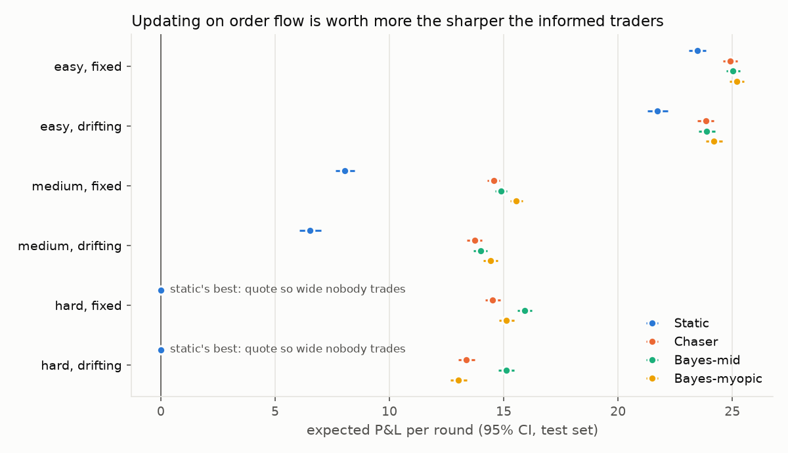
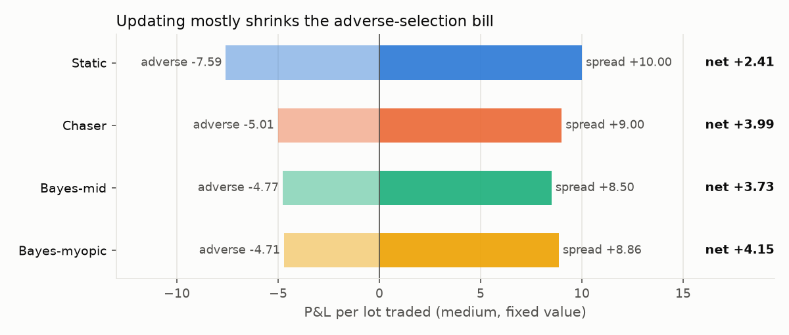

# Market-Making Trainer

[](https://github.com/Kendrichsu123/MarketMakingExercise/actions/workflows/tests.yml)

A terminal game for quoting a two-way market against **informed order flow**,
and a study of how much reading that flow is actually worth.

**TL;DR.** In a Glosten–Milgrom-style market, a quote that never updates earns
**+8.05** per round on medium difficulty. A Bayesian bot that updates an exact
posterior on V after every order earns **+15.55**, nearly double, by cutting
the adverse-selection bill per lot from −7.59 to −4.71. On hard, no fixed quote
makes money at all. But a one-line heuristic, "mark up when lifted, down when
hit", gets **about 90% of the way there**, and a 10-round session is far too
short to tell a good player from a great one.



---

## The game

Each round a hidden value **V** is drawn. Orders arrive one at a time, in
varying sizes. Each is **informed**, with a reservation price that tracks V
through noise, so it only trades when your quote is wrong in its favor, or
**noise**, anchored on the prior and uncorrelated with V. Informed orders skew
larger, so a big fill both loads inventory faster and warns that the fill was
probably toxic. You **re-quote between every order**, and inventory marks to V
at the close.

```bash
pip install -r requirements.txt
python mm_play.py
```

Pick a difficulty, fixed or drifting value, and a session length. Post a market
(e.g. `96 104`). After each order press Enter to hold or type a new market;
`skip` passes a round, `q` ends the session.

At the end, **two bots replay the exact rounds you played**, with the same value
path and the same order flow: the best fixed quote, and the Bayesian quoter. You
get your gap to each with a 95% confidence interval, and an honest "too few
rounds to tell" when the interval straddles zero.

### P&L decomposition

Each fill's mark-to-value P&L splits with your mid `m` as the pivot:

```
sell size s at ask a:  P&L = (a − V)·s = (a − m)·s + (m − V)·s
buy  size s at bid b:  P&L = (V − b)·s = (m − b)·s + (V − m)·s
                                         |_ spread _| |_ adverse _|
```

Spread is never negative. Adverse selection is negative exactly when someone
traded the correct side of your mispricing. Against noise flow it averages to
zero; against informed flow it is systematically negative. With drifting
value, a third term, **drift**, is what V's moves did to inventory you held.
The three sum to total P&L exactly (tested).

---

## The bots

| bot | how it quotes | tuned parameters |
|---|---|---|
| **Static** | `fair ± h`, never updated | `h` |
| **Chaser** | moves its mid `step` per lot toward each fill's side | `h`, `step` |
| **Bayes-mid** | exact posterior over V; quotes `posterior mean ± h` | `h` |
| **Bayes-myopic** | exact posterior over V; sets each side to maximize the expected P&L of the next fill | none |

The posterior is exact up to a 0.5-wide grid on V. Every order outcome (lift,
hit or no trade, and the fill size) has a closed-form likelihood under the
model, so each update is just Bayes' rule. With drifting value, the posterior
is convolved with the random-walk step between orders.

**Method.** Each bot is tuned on 5,000 training rounds and evaluated on 20,000
separate test rounds. Picking the best of ~80 widths on the same sample you
report would overstate the winner. Every bot plays the **same** test rounds, so
gaps between bots are paired.

---

## Results

Full tables: [`results/study_output.md`](results/study_output.md), produced by
`python study.py` (~4 min).

Expected P&L per round on the test set (± 95% CI):

| setting | Static | Chaser | Bayes-mid | Bayes-myopic |
|---|---:|---:|---:|---:|
| easy, fixed | +23.46 ± 0.37 | +24.90 ± 0.31 | +25.03 ± 0.31 | **+25.20 ± 0.32** |
| medium, fixed | +8.05 ± 0.42 | +14.56 ± 0.27 | +14.88 ± 0.27 | **+15.55 ± 0.28** |
| hard, fixed | +0.00 (doesn't trade) | +14.51 ± 0.33 | **+15.93 ± 0.32** | +15.12 ± 0.33 |
| hard, drifting | +0.00 (doesn't trade) | +13.37 ± 0.35 | **+15.10 ± 0.34** | +13.02 ± 0.36 |

**1. Updating is worth more the sharper the informed traders.** On easy it adds
~7%; on medium it nearly doubles P&L. On hard, the best fixed quote is one so
wide nobody trades: any width that gets filled is picked off by more than it
earns.

**2. The gain is almost all adverse selection.** On medium, Bayes-myopic charges
a slightly *narrower* spread than Static (+8.86 vs +10.00 per lot) but pays far
less to informed traders (−4.71 vs −7.59). Marking the mid toward V shrinks the
adverse term without needing a wider quote.



**3. A crude heuristic captures most of it.** On identical rounds, Chaser −
Static is +6.51 ± 0.31 on medium, while Bayes-mid − Chaser is only +0.33 ± 0.15.
Knowing *that* you should lean into one-sided flow is worth roughly 20× more
than computing *exactly how far*. The exact posterior earns its keep only on
hard, where it adds +1.4 to +1.7 per round.

**4. Myopic optimization stops working when information is expensive.**
Bayes-myopic, which has no tuned parameters, beats tuned Bayes-mid on easy and
medium but loses to it on hard by 0.81 (fixed) and 2.08 (drifting) per round.
It sets each quote for the next fill alone, so it quotes wide when it is
uncertain. That forgoes the fills that would have told it where V is.

**5. A short session cannot grade a player.** One round's P&L has a standard
deviation of 20–35, while the gap between two decent strategies is under 1 per
round. Even comparing on identical rounds, a 10-round session measures the
Chaser-vs-Bayes-mid gap only to ±6.7 on medium, and resolving it would take
about **4,200 rounds** (~570 on hard, where the gap is bigger). That is why the
game reports a confidence interval instead of a verdict.

---

## Structure

| file | what it is |
|---|---|
| `mm_engine.py` | the model: draws each round's randomness up front, resolves orders against quotes. Standard library only |
| `mm_play.py` | the interactive terminal game |
| `mm_sim.py` | vectorized simulation (numpy) and the four bots |
| `study.py` | tune on train, evaluate on test, write the tables and figures |
| `test_mm.py` | 21 checks, run in CI |
| `results/study_output.md` | the study's full output |

What the tests check:
- **One model, two implementations.** The vectorized simulator reproduces the
  game engine exactly, round by round, in all six settings.
- **The P&L decomposition is exact**, spread is never negative, and drift is
  identically zero with a fixed value.
- **The posterior is calibrated.** The posterior CDF evaluated at the true V is
  uniform (χ² test on 20,000 rounds). A bot told the wrong informed fraction
  fails it, with χ² = 643 against a 27.9 cutoff.
- The order-size distributions match their closed forms.

## Limitations and next steps

- **Risk-neutral scoring.** P&L marks to V, so inventory matters only through
  what it says about V, not as risk in itself. A variance penalty would make
  inventory skewing a separate decision, which is more realistic.
- **Bayes-myopic ignores the value of information.** A two-step lookahead, or
  a dynamic program over the few orders in a round, should close the gap to
  tuned Bayes-mid on hard.
- **A single market maker.** Competition would push spreads toward the
  zero-profit Glosten–Milgrom quotes, and the gap between bots would mostly
  disappear.
